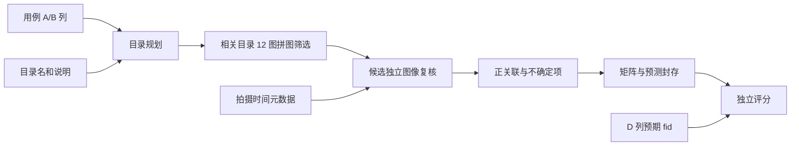

# 自然语言用例与本地图片匹配测试报告

**实验日期：2026-11-17。测试范围：100 条用例，10,489 张静态图片。**

## 1. 研究目标与主要结果

本实验验证一种可复用的图片检索工作流：读取自然语言用例，选择相关图片目录，通过视觉模型筛选和复核图片，输出用例与图片的关联集合。目标包括提高查询命中率、保留多个相关结果、降低逐用例遍历全部图库的成本，并为后续人工标注提供可复查证据。

主方法由 DeepSeek 执行目录规划、拼图筛选和独立图片复核。对照方法由 Codex 在元数据检索产生的少量候选上直接审图。评分规则为：**只要返回集合包含 D 列任意一个预期 fid，该用例即记为命中。**

新增验证集第 11–100 条中，主方法命中 **87/90（96.7%）**，Codex 辅助审图样本命中 **84/90（93.3%）**。累计前 100 条分别为 **96/100（96.0%）**和 **94/100（94.0%）**。

主方法累计覆盖 **3,075/6,256 个用例内已知正例 fid（49.2%）**。因此，96% 的用例命中率表示多数查询至少找到一个预期结果，不表示全部相关图片已经找全。由于标签只列举正例，且存在语义或时间冲突，本报告不计算真实精确率，也不把结果作为相同输入条件下的模型能力排行榜。

## 2. 数据与任务定义

### 2.1 数据来源

| 数据 | 规模或字段 | 作用 |
|---|---|---|
| 用例工作簿 `E2E_1321cases_1w_data_v19.xlsx` | 共 1,321 条；A=ID、B=查询、D=已知正例 fid | 查询输入与独立评测标签 |
| 图片索引工作簿 `ES_byFileType_user10_20261117170358.xlsx` | fid、文件名、大小、拍摄时间、已有描述等 | 本地文件映射、时间约束及声明过的元数据对照 |
| 本地图片目录 | 10,489 个静态图像文件 | 视觉检索对象 |
| 排除文件 | 37 个视频、说明文本等非静态图像文件 | 清点后排除，不作为视觉负例 |

图片包括常见位图格式以及 HEIC/HEIF、LIVP、ARW、DNG。LIVP 提取静态图，RAW 通过 rawpy 转换；本实验不分析视频时序。最终有效筛选记录中没有残留解码失败项。

| 图片目录 | 文件数 | 图片目录 | 文件数 |
|---|---:|---|---:|
| 交通 | 1,230 | 人物与活动场景 | 977 |
| 动物 | 1,068 | 卡通娱乐 | 410 |
| 建筑与场所 | 1,297 | 文档、证件与票据 | 1,027 |
| 植物 | 1,127 | 物品、古玩与艺术 | 698 |
| 美食 | 1,275 | 自然风光--旅游摄影 | 1,042 |
| 运动 | 338 | 合计 | 10,489 |

### 2.2 样本划分

前十条作为开发集，用于检查 API、图像格式、目录规划和判断规则。随后冻结推理规则，运行第 11–100 条作为新增验证集。累计结果为两者的合并统计。

该划分按原工作簿顺序选取，不是随机抽样。前 100 条以动物和动物场景为主；新增查询包含与开发集近义或相近的主题，例如白虎、火烈鸟和树枝。因此，“新增验证集”表示未用于此前方法调整的查询行，不等同于严格独立的语义分布或跨领域测试。

### 2.3 fid 与图片映射

先以文件名和字节大小匹配本地图片；若没有大小匹配，则只接受唯一同名匹配。歧义同名或本地缺失分别保留，不任意指定图片。

同一用例的重复 fid 去重。一个 fid 如对应多个确认的本地文件，召回其中任意一个即可记为该 fid 命中。累计 100 条标签包含 6,256 个“用例—fid”正例关系，涉及 2,222 个不同 fid；其中 67 个用例内正例关系无法映射到本地图片，仍保留在原始覆盖率分母中。67 是关系数，不是不同缺失文件数。

## 3. 主方法



### 3.1 目录规划

规划模型只接收用例 ID、查询、目录名、目录数量和目录说明。通常为每个查询选择 1–3 个目录；跨类别场景允许更多。输出包括视觉必要条件、时间条件和目录选择理由。

采用每批十条查询的方式复用目录筛选。主方法不根据文件名猜测具体图片，也不把目录内全部图片直接记为相关。

### 3.2 拼图筛选

相关目录按 12 张图片组成带稳定图片 ID 的拼图，四列排列，每格宽 320 像素。筛选目标是高召回：输出所有可能匹配的图片及其查询 ID，不只选择最相似的一张。不同查询可共享同一次拼图请求。

开发阶段的提示词包含白虎属于老虎、鸟与枝条关系、海洋馆场景及主体数量等校正说明。新增验证集沿用相同提示词，未在计分后按答案调整。

### 3.3 独立图片复核

每次请求最多提供四张独立图片，各图长边不超过 1,200 像素。模型逐图、逐查询返回：

- `relevant`：满足必要条件，正式计为正关联；
- `uncertain`：细节或时间证据不足，进入待核实集合；
- `irrelevant`：不满足条件。

年份只使用索引中的 `shootingTime`，不从画面猜测。该字段并不必然等于真实拍摄时间，其与查询、标注的冲突属于后续数据复核范围。主视觉方法不读取已有图片 caption、语义标签或 OCR 描述。

### 3.4 缓存、失败与矩阵

成功响应记录模型返回名称、Token 用量和图像摘要。传输或 JSON 解析异常最多尝试三次，结构校验失败最多进行一次专门的格式修复。未完成的图批不能当成负例。

扩大批次时曾出现共享缩略图写入未完成便被其他线程读取的执行错误。修复方式是按稳定图片 ID 加锁、校验派生 JPEG、保留受影响记录并重跑相应拼图。该修复没有改变模型提示词或相关性规则。最终筛选覆盖检查通过，解码错误数为零。

| 矩阵值 | 含义 |
|---|---|
| `1` | 独立图片复核确认相关 |
| `0` | 拼图筛选或单图复核未命中 |
| `?` | 待核实，不计入正式命中 |
| `S` | 该查询未搜索该图片所在目录 |
| `E` | 解码失败 |
| 空白 | 用例未运行；Codex 对照矩阵中表示未记录正关联 |

主方法的 `0` 含缩略图筛选结论，不是精细人工负例。`S`、`E` 或空白不能解释为确认不相关。

## 4. 对照方法与输入差异

### 4.1 Codex 元数据辅助直接审图

候选预筛使用 ES 已有描述中的关键词、同义词和时间字段，不读取用例 D 列。新增 90 条的候选规则按 B 列人工编写，公开于 `codex_candidate_rules.json`。不同关键词组之间取交集，同一组内取同义词并集，并按匹配次数及描述前部出现情况排序；涉及年份的查询另使用时间条件。

每条查询通常检查前四个候选，没有足够候选时不补足固定数量。TC0066 与 TC0100 额外检查候选 5–8，TC0066 还查看了一张独立放大图。最终新增 90 条共检查 **334 次用例—图片组合、267 张不同图片**，保留 **251 条正关联**。复看同一图片不会重复增加该覆盖计数。

该对照是由 Codex 直接查看像素后产生的有限样本判断，不是对 90×10,489 个组合的穷举标注。其最终选择在本次标签计分前封存。Codex 的具体后端模型版本未单独记录，因此该结果只作为审图工作流对照，不适合作为可严格复现的模型排行榜条目。

开发集的 Codex 对照使用元数据候选拼图及单图复看，返回 111 条正关联；其候选方式与新增验证集不完全相同。累计 94% 因此是历史工作流的汇总，不是统一自动候选策略的单次受控实验。

### 4.2 元数据规则基线

另有一组仅覆盖开发集十条的固定关键词规则，使用已有标签和描述，未进行逐图视觉确认。该基线命中 10/10，返回 970 条关联，覆盖 453/842 个已知 fid（53.8%）。由于规则只为开发集十条实现，新增 90 条及累计 100 条不报告该基线成绩。

### 4.3 可比较范围

| 项目 | DeepSeek Skill | Codex 直接审图样本 | 元数据规则基线 |
|---|---|---|---|
| 目录规划与批量视觉筛选 | 是 | 否 | 否 |
| 使用已有图片语义描述 | 否 | 候选预筛使用 | 是 |
| 直接查看图像 | 拼图及候选独立图 | 少量候选直接审图 | 否 |
| 时间条件 | ES 拍摄时间字段 | 候选规则与时间字段 | 仅已实现规则 |
| 新增 90 条覆盖 | 完成所选目录筛选与候选复核 | 334 次组合检查 | 未实现 |
| 可自动重复执行 | 是 | 候选规则可复用，最终审图依赖审核者 | 仅开发集规则 |

命中率差异同时受到候选范围、元数据信息和返回集合大小的影响，不能单独归因于视觉模型能力。

## 5. 指标与实验隔离

令用例 q 的预期 fid 集合为 Gq，正式返回图片集合为 Rq，fid 到本地图片集合的映射为 M(f)。

- 用例命中：Gq 中至少存在一个 f，使 M(f) 与 Rq 有交集。
- 用例命中率：有标签用例中，命中用例数除以有标签用例总数。
- 已知 fid 覆盖率：各用例已命中 fid 数之和，除以各用例预期 fid 数之和。
- 返回关联数：用例—图片正关联总数；同一图片对应不同用例分别计数。

待核实图片不进入正式返回集合。没有标签的用例不作为错误负例计分；本次 100 条均有标签。无法映射的预期 fid 保留在原始分母中，不通过删除缺失数据提高成绩。

推理读取用例 A/B 列，标签评分随后进行。新增主方法预测和 Codex 审图选择均在本次计分前封存，保留源文件哈希、预测哈希与代码快照。公开哈希用于检查文件一致性和本地实验溯源，不构成第三方时间戳或对执行顺序的独立认证。公开数据经过脱敏转换，主方法原始预测文件的历史哈希不等同于公开 JSON 的哈希。

## 6. 定量结果

| 范围与方法 | 用例命中 | 命中率 | 返回关联数 | 已知 fid 命中/总数 | 已知 fid 覆盖率 |
|---|---:|---:|---:|---:|---:|
| 开发集 1–10：Skill | 9/10 | 90.0% | 447 | 329/842 | 39.1% |
| 开发集 1–10：Codex 审图 | 10/10 | 100.0% | 111 | 107/842 | 12.7% |
| 开发集 1–10：元数据规则 | 10/10 | 100.0% | 970 | 453/842 | 53.8% |
| 新增 11–100：Skill | 87/90 | 96.7% | 7,212 | 2,746/5,414 | 50.7% |
| 新增 11–100：Codex 审图 | 84/90 | 93.3% | 251 | 238/5,414 | 4.4% |
| 累计 1–100：Skill | 96/100 | 96.0% | 7,659 | 3,075/6,256 | 49.2% |
| 累计 1–100：Codex 审图 | 94/100 | 94.0% | 362 | 345/6,256 | 5.5% |

新增 Skill 另有 924 条待核实关联，累计为 973 条。若仅将待核实集合加入“候选召回”统计，新增集可覆盖 88/90 条用例；这不是正式相关性成绩，本报告仍使用 87/90。

累计 Skill 矩阵共有 1,048,900 个单元格：`1` 为 7,659，`?` 为 973，`0` 为 149,068，`S` 为 891,200，`E` 为零。大量 `S` 体现目录路由缩小了检索范围，也说明该矩阵不是对全部组合的视觉判定。Codex 矩阵为 362 个正关联，其余单元格留空。

完整 100 条结果见 [逐条 CSV](../benchmarks/2026-11-17/data/cases_100.csv)；可独立重算的数据见 [benchmark.json](../benchmarks/2026-11-17/data/benchmark.json)。

## 7. 未命中用例与计分后复查

### 7.1 主方法的四个累计未命中用例

| 用例 | 查询 | 主要观察 |
|---|---|---|
| TC0009，开发集 | 2013年 小鳄鱼 | 有相应时间元数据的已知正例在拼图阶段未进入候选。 |
| TC0050，新增集 | 2010年 小猫 | 27 个预期图中，仅两张时间字段为 2010，画面均为老虎；其他图时间字段均非 2010。需核对查询、时间字段与标签语义。 |
| TC0051，新增集 | 蝾螈 | 图片 I02671 在拼图阶段未进入候选；预期集合还包含蛙类及鳄鱼画面，物种标签需复核。 |
| TC0100，新增集 | 帮我找下白色的麻雀 | 多张预期图为雪地中的棕褐色麻雀，还包含景观和线稿；颜色条件与标签需核对。 |

这些观察是在计分后查看预期图片得到的诊断。没有将这些图片回填预测，也没有删除疑似问题标签重新计算更高成绩。图像判断不能独立证明真实拍摄年份；TC0050 的时间冲突是与提供的元数据比较所得。

### 7.2 Codex 对照的六个新增未命中用例

TC0023“动物”、TC0040“帮我找下梅花鹿和锦鲤”、TC0050“2010年 小猫”、TC0054“动物照片”、TC0078“动物模型”、TC0100“帮我找下白色的麻雀”。

“动物”和“动物照片”各只返回一张，有限候选未覆盖 D 列集合。组合查询“梅花鹿和锦鲤”被按同图同时出现解释；实际检索任务可能需要多个主题的并集，后续应明确该语义。“动物模型”的 26 个预期 fid 中有 7 个无法映射本地，四张审图正选均未命中已列标签。正例集不完整时，返回图片不在 D 列不能直接证明该图片语义不相关。

### 7.3 已知 fid 漏召回阶段

新增验证集共有 2,668 个用例内预期 fid 未命中，归因如下。该归因使用原始标签，包含前述疑似标注问题，不能把每一项都解释为模型实际误判。

| 阶段 | 未命中 fid 关系数 | 占比 |
|---|---:|---:|
| 拼图筛选未选中 | 1,070 | 40.1% |
| 图片目录未选择 | 1,002 | 37.6% |
| 单图复核拒绝 | 408 | 15.3% |
| 待核实 | 128 | 4.8% |
| 本地映射缺失 | 60 | 2.2% |
| 合计 | 2,668 | 100.0% |

拼图筛选与目录路由合计占 77.7%，说明候选召回是当前优先检查的环节。小目标、跨目录背景及复杂场景容易在进入单图复核前被遗漏。

## 8. 调用用量与执行检查

模型请求使用 `deepseek-flash`，响应中记录的模型名称也为 `deepseek-flash`。温度为 0，思考模式关闭，JSON 响应模式，最大输出 5,000 tokens。新增验证每批十条用例，批次内筛选和复核各使用八个工作线程，最多两个用例批次并行，网络调用并发上限 16。

| 新增 90 条成功缓存响应 | 数量 |
|---|---:|
| 目录规划 | 9 |
| 拼图筛选 | 3,528 |
| 单图复核 | 3,096 |
| 单图响应结构修复 | 2 |
| 合计 | 6,635 |

新增集成功缓存响应记录输入 **15,086,161 tokens**、输出 **1,071,522 tokens**，合计 **16,157,683 tokens**。该统计含保留的成功重跑或结构修复响应，不一定等于最终有效图批数；未成功保存的响应及传输重试不一定在统计中，因此不能直接作为完整账单。Codex 审图的模型用量和总耗时未单独记录，不能据此比较两种方法的总费用或速度。

累计有效筛选记录为 **3,996 个图批**；跨用例批次记录的独立图片复核文件共 **13,514 个**，包含同一图片在不同查询批次中的重复复核，不是不同原图数。

源工作簿 SHA-256、原图大小和修改时间检查通过。两份 100×10,489 矩阵的状态数、正关联集合与逐条结果一致，最终解码错误为零。复核环境为 Python 3.14.6、Pillow 13.0.0、pillow-heif 1.8.1、openpyxl 3.1.5、rawpy 0.28.0，详见 `provenance.json`。

## 9. 公开材料与复现方式

### 9.1 无需私有数据的数值复核

```powershell
python -m pip install -r skills/image-case-retrieval/scripts/requirements.txt
python tools/verify_report.py
```

脚本使用 SHA-256 转换后的 fid、稳定图片 ID、预测集合及矩阵，重新计算逐条命中、已知 fid 覆盖、三组汇总及开发集元数据基线，并检查文件哈希。匿名化保留同一 fid 跨用例的一致性和完整映射关系，因此不改变命中计算。

公开材料不包含原图、原始 fid、原始文件名、caption、私有绝对路径或 API 密钥。数值复核可以独立进行，图像内容及标签语义的外部复审仍需要原始数据。公开的计分后定性观察不是独立第三方完成的标签质量审核。

### 9.2 重新执行工作流

持有同格式数据及有效视觉 API 凭据后，按 [运行说明](usage.md) 分批执行，再独立评分。模型服务使用别名，未来版本变化、接口实现和生成随机性都可能使结果与历史记录不同；温度为零不保证逐项相同输出。

历史归档代码位于 `benchmarks/2026-11-17/frozen/`。为移除原机器路径，仅将 `pipeline.py` 的默认根目录通用化；原始与公开副本哈希及变换记录均保存。其他历史推理规则及提示词保持原样。历史协调器依赖原实验布局，不作为通用入口。

发布版 `skills/image-case-retrieval/scripts/` 另作了工程整理：提供跨平台入口；确保默认执行完成预测导出；将标签评分分离；校验输入与阶段完整性；采用原子 JSON/JPEG 写入、缓存加锁及鉴权失败停止。**发布版未重新运行这 100 条真实模型评测；本报告成绩属于历史冻结实验。**自动化测试验证的是入口、续跑和失败处理等软件行为，不替代检索效果验证。

## 10. 适用边界与改进方向

本方法适用于具备类别目录及结构化索引的本地图库，能够自动生成检索与标注候选；当前证据支持较高的“至少命中一个已知正例”比例，尚不支持完整召回或真实精确率结论。样本规模、主题分布、正例不完整、元数据可信度及两种对照输入不一致均限制外推。

建议先复核存在时间、颜色和物种冲突的标签，明确组合查询的并集与同图语义；再将已有描述检索与目录视觉检索取候选并集，并保留单图视觉确认。该改动应作为新的方法版本，不能沿用本报告分数。

对小目标可减少拼图格数、提高目标局部分辨率或增加二次筛选；对门、场所、人物活动等跨目录查询，可保留全库文本兜底。扩大到上千条用例时，应优先建立一次性可复用的图片描述索引，减少同一原图在多个查询批次中的重复视觉调用。

后续评测应使用语义上独立的查询集，并对返回结果抽样补充正负标注，分别评估候选召回、结果精确率、标注成本和运行费用。
