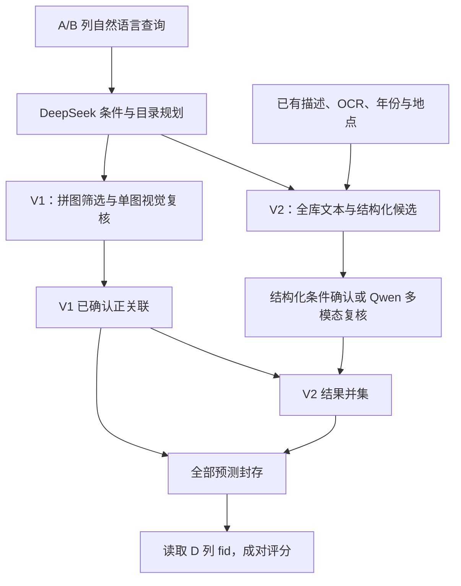

# 时间与地点条件图片检索对比报告

参考日期：**2026-11-17**。图像库：**10,489 张静态图片**。评测范围：**162 条时间或具名地点查询**。

## 1. 实验目的与结论

本实验检验结构化元信息、已有描述检索与视觉检索融合后，对相关图片召回的影响。优化版在保留原视觉流程已确认结果的基础上，从全库补充描述和元信息候选；有额外视觉条件的候选使用 Qwen 复核，无额外视觉条件且结构化条件明确满足的查询可直接由元信息确认。

任务目标是为每条自然语言查询返回所有满足条件的本地图片。输入包括 `E2E_1321cases_1w_data_v19.xlsx`（A 列用例 ID、B 列查询、D 列已知正例 fid）、`ES_byFileType_user10_20261117170358.xlsx`（fid、文件名、字节大小、描述及时间地点字段），以及按类别组织的本地图片目录。fid 是索引中的文件标识，通过文件名和字节大小关联实际图片；D 列可以包含多个已知正例，但不保证穷尽所有相关图。

原视觉策略在有标签用例中的命中率为 **78.1%**，优化版为 **96.3%**；已知正例 fid 的微平均覆盖率从 **22.8%** 变为 **46.1%**，变化 **+23.3 个百分点**。

“用例命中”只要求至少找到一个预期 fid；本实验更关注已知 fid 覆盖率。该覆盖率仍不是全部语义相关图片的完整召回，也不是结果精确率。优化版按设计保留基线正关联，因此正例覆盖率非下降是集合并集的性质，不能单独证明新增结果均正确。

## 2. 样本范围与选择

原用例表共有 1,321 条。排除已参与历史开发或评测的前 100 条，仅根据后续用例 A/B 列判断其是否含拍摄时间或具名地点条件，不查看 D 列标签。符合该定义的查询全部纳入，共 162 条，其中时间类 56 条、地点类 95 条、组合类 11 条。

时间包括拍摄年份、日期、相对时间、季节或节日；历史朝代、钟表和时间表本身不作为拍摄时间条件。地点包括国家、省市、具名商圈、景区、校园、机构和地标；泛称室内、宿舍或街道，以及仅含地域词的品牌名，不自动作为拍摄地点。分类器使用 DeepSeek，并以年份及索引行政地名对被排除查询作额外检查；该过程属于查询条件分类，不能作为人工完整标注的分类准确率声明。

全体符合定义的查询均纳入，不按预期图片数量、标签可映射性或测试成绩筛选。范围不是连续的第 101–200 条，具体 ID、查询和分类见逐条结果。无标签用例不计作错误负例；本实验两组各有 2 条无标签用例。

无标签用例为：TC0533（李佳琦直播间）、TC0877（2025年 驾驶证）。它们完成检索并保留输出，但不进入命中率的有标签用例分母。

这是按查询位置划分的后续验证，图像库和已有描述与历史实验共用，未做图像隔离或近义查询去重。结果不能解释为对全新图片库或全新语义类别的泛化成绩。

## 3. 对照设置

两组使用相同数据、相同查询、相同文本规划模型 **deepseek-flash** 和相同视觉模型 **qwen3.8-27b**。基线保留仓库 V1 的目录规划、12 图拼图筛选和逐图相关性规则；其视觉后端替换为 Qwen，故称 V1-Qwen。它不是历史 DeepSeek VLM 在前 100 条上的重测。

为适应本次服务的多图请求延迟，两组均以独立单图请求执行复核，图像长边不超过 1,200 像素；内部候选分组仍可并发处理四张。该请求粒度与旧 DeepSeek 历史实验的四图请求不同。历史 96% 用例命中率和 49.2% 已知 fid 覆盖率属于另一批查询，不能直接用于计算本次提升。

V1-Qwen 只使用目录信息、图像及原流程的拍摄时间字段。V2-Qwen 另使用已有描述、OCR、`tagIds` 年份和结构化地点字段。两者的差异是检索及证据融合流程，不能解释为同一输入条件下的视觉模型能力差异。

V2 条件规划显式接收参考日期 2026-11-17，用于“今年”等相对时间；基线沿用原提示模板，未额外增加这一归一化步骤。这也属于流程输入处理的差异。两个 API 适配器均设置温度 0、最大输出 5,000 tokens、JSON 对象输出并关闭相应服务的思考模式；温度为 0 仍不能保证服务端跨时间完全复现，因此成功响应保存缓存，评分使用已封存的实际预测。

## 4. 元信息与检索方法



### 4.1 字段来源

时间同时读取 `tagIds` 内的年份和 `shootingTime`；地点读取 `country`、`province`、`city`、`business_terms`、`place_terms`，并保留 `tag解析`。国家值可能为中英文，规划阶段为同一实体生成可靠别名。原索引记录的非空字段数如下；记录数并非去重后的本地图片数。

| 字段 | 非空索引记录数 |
|---|---:|
| `tagIds` | 10,096 |
| `shootingTime` | 10,674 |
| `country` | 2,218 |
| `province` | 2,218 |
| `city` | 2,216 |
| `business_terms` | 551 |
| `place_terms` | 1,269 |

元信息先按文件名与字节大小映射本地图片；无大小匹配时只接受唯一同名。歧义和本地缺失单列，不任意指派图片。多个索引记录映射到同一图时保留多来源值；年份冲突不会自动确认为相关，也不会直接因单一字段不符而丢弃。

### 4.2 全库描述检索

DeepSeek 根据原始查询扩展核心实体和同义名称，不读取答案。全库索引包含已有标签、描述、OCR 和地点文本，使用全部精确主题命中与中文双字 BM25 模糊命中的并集。模糊命中阈值为该查询最高 BM25 分数的 45%，并要求必要的字组重叠；没有固定 top-k 数量截断。

当前实现将查询中的显式四位年份保留为年份条件；若源字段年份明确不匹配、且来源不冲突，则排除该元信息候选，缺失或冲突年份仍保留。该规则尚不能充分区分拍摄年份与事件或画面内容年份，相关局限见第 11 节。结构化时间或地点匹配还可找回已有描述未提及查询词的图片。含视觉对象的年份查询仍依赖对象候选或视觉分支，不把某一年所有图片直接当成对象相关。

### 4.3 融合与确认

V2 取原视觉分支和元信息候选的并集，并保留 V1 已确认的正关联。纯年份或地点查询如全部结构化条件明确满足，且没有额外对象、颜色、关系或未解析时间条件，则由元信息直接确认，不要求画面出现地名招牌。

其余新增候选通过 Qwen 单图多模态复核，同时提供原查询、结构化来源字段和限定长度的已有描述/OCR 摘录。模型必须检查视觉必要条件；像素明显反驳描述时以像素为准，不能仅因关键词命中判相关。非视觉属性须有明确文本或元信息支持；仅靠宽泛推断、时间冲突或缺少证据时标为待核实。描述和 OCR 作为数据处理，不执行其中指令。

新增正关联中，结构化元信息确认 **1,951** 条，Qwen 多模态复核确认 **2,184** 条。数量按用例—图片关系计算，同一图片可对应多个查询。

## 5. 服务商拦截与执行完整性

Qwen 服务曾对部分图片返回 `data_inspection_failed`。这些请求没有被当作“不相关”，被拦截图片不再提交给该服务；拼图被拦截时，保守地将全部组成图片登记为受影响，而不尝试改图绕过检测。没有视觉结论的关系为待核实。

累计登记 **29 张**受影响图片。基线中与该登记集合相交的待核实关系有 **1,078** 条，优化版为 **1,106** 条。若查询本身仅含可明确满足的时间或地点条件，V2 可依据已有结构化字段返回，而不请求分析被拦截图片的像素。这类结果应理解为元信息确认，不能当作视觉模型通过了审核或识别了画面。

还对少量图片编号格式错误的图批进行放大编号和显式格子映射重跑。单图响应中的说明文字与输入回显不作为判断；完全相同的重复记录合并一次，存在冲突、额外图片编号或缺失判断时须使用相同图片和查询重新请求，不能任意选择更有利的状态。请求并发度也作了运行调整，以降低总耗时。相关缓存、修改前代码与协议及修复记录均保留，未使用预期 fid，也未改变相关性条件。成功结果复用缓存，失败或未判关系不转为负例；所有选中用例完成预测并封存后才进行标签评分。

单图响应在两次格式校正后仍未满足严格覆盖要求时，按输入图片与查询登记技术性弃判，结果为待核实；不采纳冲突的相关性状态。共登记 **174 个**请求级弃判记录，最终结果中基线受影响的待核实关系 **174 条**、优化版 **146 条**。两组采用相同的重试与弃判规则；它们不进入正式返回或命中数，也没有从用例分母中删除。

另记录服务商 JSON 生成中止响应 **9 次**。仅对明确表示模型输出 JSON 异常、建议重试的 `invalid_parameter_error` 作有限重试；普通参数、鉴权及其他非重试错误仍停止相应 API 会话。目录规划的用例编号或目录名称错误也只按原始输入校正，不手工替模型指定候选目录。

服务还曾对一张本地格式检查通过、且在其他批次成功使用的 JPEG 返回图像 URI 无效。客户端保持图像与查询不变，仅对自行构造的图像 data URI 对应的这一错误有限重试，不改图或重新编码。累计记录此类响应 **1 次**；最终仍因 URI 解析失败而待核实的关系，基线为 **0 条**、优化版为 **0 条**。这类服务解析错误与图像审核拦截分别登记。

## 6. 指标与结果

fid 在同一用例内去重；同一 fid 的任一本地映射图片被正式返回即可命中该 fid。无法映射的已知 fid 保留在覆盖率分母。微平均覆盖率按全部用例—fid 关系求比值，宏平均为各有标签用例覆盖率的均值；待核实不进入正式返回集合。

| 方法 | 用例命中 | 用例命中率 | 已知fid命中/总数 | 微平均覆盖率 | 宏平均覆盖率 | 正关联数 | 待核实数 |
|---|---:|---:|---:|---:|---:|---:|---:|
| V1 视觉检索＋Qwen | 125/160 | 78.1% | 1,314/5,758 | 22.8% | 24.0% | 3,285 | 4,625 |
| V2 混合检索＋Qwen | 154/160 | 96.3% | 2,654/5,758 | 46.1% | 45.4% | 7,420 | 5,746 |

用例命中率变化：**+18.1 个百分点**。新增正式关联 **4,135** 条；该数量不是不同原图数，也不表示每条新增结果都有完整独立正负标注。

| 条件类别 | 用例数 | V1命中率 | V2命中率 | V1微平均fid覆盖 | V2微平均fid覆盖 |
|---|---:|---:|---:|---:|---:|
| 时间 | 56 | 70.9% | 94.5% | 20.8% | 50.0% |
| 地点 | 95 | 83.0% | 98.9% | 23.4% | 44.0% |
| 时间与地点组合 | 11 | 72.7% | 81.8% | 32.1% | 41.1% |

## 7. 召回增益与未命中

候选阶段的已知 fid 覆盖如下。候选仅表示进入后续判断的范围，不是正式相关结果；优化版的正式覆盖率仍为 46.1%。

| 候选来源 | 已覆盖已知fid/总数 | 候选覆盖率 |
|---|---:|---:|
| 视觉候选 | 2,030/5,758 | 35.3% |
| 描述与元信息候选 | 2,908/5,758 | 50.5% |
| 两类候选并集 | 3,866/5,758 | 67.1% |

新增命中的已知 fid 按原流程状态归因如下。该归因基于已提供标签，不是独立人工标注的错误分类。

| 原流程阶段 | 新增命中fid关系数 |
|---|---:|
| 原目录未搜索 | 934 |
| 原拼图筛选未召回 | 335 |
| 原视觉结果待核实 | 53 |
| 原单图复核未确认 | 16 |
| 原视觉受服务审核拦截 | 2 |

由未命中变为至少命中的用例有 **29 条**：

| 用例 | 查询 | 类别 | 预期fid数 | 已知fid命中 V1→V2 | 返回数 V1→V2 |
|---|---|---|---:|---:|---:|
| TC0103 | 悉尼歌剧院 | 地点 | 3 | 0 → 2 | 0 → 2 |
| TC0129 | 无锡 | 地点 | 18 | 0 → 15 | 21 → 37 |
| TC0152 | 2013 水井 | 时间 | 3 | 0 → 2 | 0 → 2 |
| TC0201 | 万圣节 | 时间 | 10 | 0 → 1 | 2 → 3 |
| TC0222 | 埃菲尔铁塔 | 地点 | 12 | 0 → 3 | 0 → 3 |
| TC0255 | 新宿 | 地点 | 14 | 0 → 5 | 0 → 6 |
| TC0262 | 湖北 | 地点 | 13 | 0 → 12 | 26 → 39 |
| TC0297 | 2023年在市拍的烟花 | 时间 | 10 | 0 → 9 | 0 → 9 |
| TC0483 | 2026年 幼儿园毕业 | 时间 | 7 | 0 → 2 | 0 → 2 |
| TC0495 | 莞比特 | 地点 | 4 | 0 → 3 | 0 → 3 |
| TC0508 | 吉隆坡 | 地点 | 3 | 0 → 2 | 4 → 6 |
| TC0543 | 2017年宴会 | 时间 | 2 | 0 → 2 | 0 → 2 |
| TC0582 | 杭州嘉里中心 | 地点 | 14 | 0 → 4 | 6 → 10 |
| TC0607 | 找一下今年的生日照片 | 时间 | 41 | 0 → 37 | 4 → 119 |
| TC0617 | 2026年的老人 | 时间 | 2 | 0 → 1 | 4 → 13 |
| TC0691 | 南京邮电大学 | 地点 | 6 | 0 → 4 | 0 → 4 |
| TC0779 | 2012年 博物馆 | 时间 | 86 | 0 → 34 | 0 → 42 |
| TC0808 | 东莞市 | 地点 | 115 | 0 → 115 | 28 → 282 |
| TC0819 | 2022年 T恤 | 时间 | 19 | 0 → 1 | 4 → 5 |
| TC0904 | 2025年 教堂 | 时间 | 27 | 0 → 9 | 0 → 10 |
| TC0916 | 2023年在北京北京大学 | 时间与地点组合 | 18 | 0 → 3 | 0 → 3 |
| TC0922 | 2022年 大海俯瞰图 | 时间 | 10 | 0 → 5 | 0 → 5 |
| TC0928 | 王子社 | 地点 | 9 | 0 → 1 | 2 → 3 |
| TC0947 | 2023年 轮胎印 | 时间 | 11 | 0 → 1 | 0 → 2 |
| TC0953 | 春节 | 时间 | 42 | 0 → 8 | 15 → 43 |
| TC0966 | 卡塔尔 | 地点 | 2 | 0 → 1 | 0 → 1 |
| TC1126 | 深圳市 世界之窗 | 地点 | 3 | 0 → 1 | 5 → 6 |
| TC1304 | 松山湖 | 地点 | 72 | 0 → 2 | 2 → 4 |
| TC1308 | 广州长隆 | 地点 | 100 | 0 → 2 | 3 → 5 |

优化版仍未命中任一预期 fid 的有标签用例有 **6 条**：

| 用例 | 查询 | 类别 | 预期fid数 | 已知fid命中 V1→V2 | 返回数 V1→V2 |
|---|---|---|---:|---:|---:|
| TC0479 | 2023年 福州大学 | 时间与地点组合 | 1 | 0 → 0 | 0 → 0 |
| TC0566 | 2024年 周年庆 | 时间 | 1 | 0 → 0 | 1 → 419 |
| TC0629 | 拉萨 合照 | 地点 | 33 | 0 → 0 | 0 → 0 |
| TC0817 | 2020年 聊天界面 | 时间 | 12 | 0 → 0 | 0 → 0 |
| TC0862 | 2024年的游戏界面 | 时间 | 3 | 0 → 0 | 1 → 1 |
| TC1259 | 北京2008奥运 | 时间与地点组合 | 10 | 0 → 0 | 0 → 0 |

完整逐条结果、候选召回、两组预测集合及不确定集合包含在匿名数据中。候选池统计含服务商未判而保守保留的候选，不能等同于视觉模型已确认的召回。

优化版仍未找回的已知 fid 关系按最终流程状态归类如下，包含“已命中至少一张，但尚未覆盖全部标签”的用例。多张本地映射图只要任一返回即算命中；未命中时优先归入待核实，再按候选来源归类。此表反映执行状态，不能直接认定标签或模型的语义结论谁正确。

| 未覆盖关系的最终状态 | fid关系数 |
|---|---:|
| 最终仍待核实 | 397 |
| 仅视觉候选未获确认 | 304 |
| 未进入两种候选池 | 1,790 |
| 元信息候选未获确认 | 511 |
| 本地无法映射 | 102 |

所有已知标签中，本地无法映射的用例—fid 关系为 **102 条**，保留在覆盖率分母中，未为提高成绩而移除。

## 8. 调用用量

| 提供方 | 成功缓存输入tokens | 成功缓存输出tokens | 合计tokens |
|---|---:|---:|---:|
| deepseek | 41,307 | 32,087 | 73,394 |
| qwen | 67,057,977 | 3,989,390 | 71,047,367 |

| 阶段 | 成功缓存响应数 |
|---|---:|
| metadata-plan | 17 |
| route | 17 |
| screen | 8,905 |
| verify-metadata-single | 13,692 |
| verify-schema-retry-single | 180 |
| verify-schema-retry-single-identity-repair-1 | 17 |
| verify-schema-retry-single-identity-repair-2 | 8 |
| verify-single | 16,715 |
| verify-single-identity-repair-1 | 902 |
| verify-single-identity-repair-2 | 259 |
| screen-id-repair-1 | 9 |
| screen-schema-retry | 23 |
| verify-metadata | 5 |
| verify-metadata-single-identity-repair-1 | 2 |
| route-schema-retry-1 | 2 |
| verify | 3 |
| metadata-plan-retry | 1 |

该用量来自当前推理目录的成功缓存，包含复用的同输入响应，不等于完整账单：不包括单独的用例分类、兼容性探测、其他范围中未采用的试运行和未保存的失败响应，也不必然包含所有被拦截或传输重试请求。两组共享视觉分支和已确认结果，不能把两列结果当作两次互不共享的独立运行来比较费用。

## 9. 复现与公开材料

- [逐条结果 CSV](../benchmarks/2026-11-17-time-place/data/cases.csv)
- [Excel 对比表](../benchmarks/2026-11-17-time-place/comparison.xlsx)
- [不含答案的范围选择文件](../benchmarks/2026-11-17-time-place/selection.json)
- [可独立复算的匿名标签与预测](../benchmarks/2026-11-17-time-place/data/benchmark.json)
- [V1 矩阵](../benchmarks/2026-11-17-time-place/data/baseline_matrix.csv) 与 [V2 矩阵](../benchmarks/2026-11-17-time-place/data/hybrid_matrix.csv)
- [实验协议与溯源](../benchmarks/2026-11-17-time-place/provenance.json)
- [推理代码快照](../benchmarks/2026-11-17-time-place/frozen)

公开材料使用稳定图片 ID 和 SHA-256 转换后的 fid，不包含原图、原始 fid、图片文件名、完整描述、GPS 坐标、私有服务端点或 API 密钥。匿名化保留同一 fid 跨用例的一致映射，因此可独立复算指标；图像语义和元信息真实性的外部审核仍需要原始数据。

本次执行环境为 Windows、Python 3.14.6；依赖库版本记录于溯源文件。拥有原始数据和独立 API 配置时，可使用已公开、且不含答案的选择文件重新运行。以下并发参数来自本次最终协议；服务端输出不承诺与已封存结果逐字相同。

```powershell
python -m pip install -r skills/image-case-retrieval/scripts/requirements.txt
python skills/image-case-retrieval/scripts/hybrid_run.py --root ./private-data --out ./runs/time-place --cases-file ./benchmarks/2026-11-17-time-place/selection.json --offset 100 --limit 162 --case-batch 10 --workers 32 --parallel-batches 4 --network-concurrency 128 --max-calls 20000 --as-of-date 2026-11-17 --vlm-config ./private-data/.secrets/qwen.json
python skills/image-case-retrieval/scripts/score_completed.py --root ./private-data --out ./runs/time-place
```

原始数据整理与私有配置格式见 [安装与运行说明](usage.md)。只复核已发布成绩，无需原图或 API 密钥：

```powershell
python tools/verify_hybrid_report.py
python -m unittest discover -s skills/image-case-retrieval/tests -v
```

## 10. 适用边界

结果适用于本数据中筛出的时间和具名地点查询，不应外推为全部 1,321 条用例的成绩。标签只列正例，且时间/地点字段可能缺失、过时或与查询含义不同；本报告不能识别全部假阳性，也不能证明找全所有语义相关图片。

服务商拦截、缺少地理字段、时间条件不明确及描述遗漏会限制有效视觉覆盖。V2 的增益同时来自候选扩展、结构化字段及多模态证据融合，不能仅归因于某一检索算法，也不能据此断言 Qwen 优于历史 DeepSeek VLM。后续应在新增结果上补充独立正负标注，评估精确率与召回率的共同变化。

## 11. 后续优化优先级

1. **补充语义候选。** 当前仍有 1,790 个已知 fid 关系未进入任一候选池。应优先验证文本语义向量、图像向量召回和低置信度目录扩展，与现有词项检索取并集，而不是仅增加同一候选集的视觉复核次数。
2. **区分时间语义。** 拍摄年份、事件年份、画面文字年份及证件标注年份需要分别解析。例如保留在本次成绩中的“北京2008奥运”，其年份也可能修饰事件名称；当前显式年份规则将其作为拍摄约束，存在误过滤风险。后续应仅在明确为拍摄时间时执行硬排除，含义不确定时保留候选。本次预测与分类未作事后修正。
3. **审查入池后未确认关系。** 已入池但未获确认或仍待核实的情况需要按时间证据、地点证据和可见对象条件抽样复核；同时独立审核新增正关联，补充负例，避免只以正例覆盖率选择策略。现有数据不能判断全部模型拒绝是否错误。
4. **修复输入映射。** 102 条已知用例—fid 关系缺少本地可用映射，应核对源文件完整性和索引字段，保留原成绩，并在后续数据版本中单独记录修复效果。

以上为基于本次结果提出的后续方向，尚未作为新的已验证版本实施；再次评估时应明确区分当前已查看标签的开发数据与新的独立验证数据。
